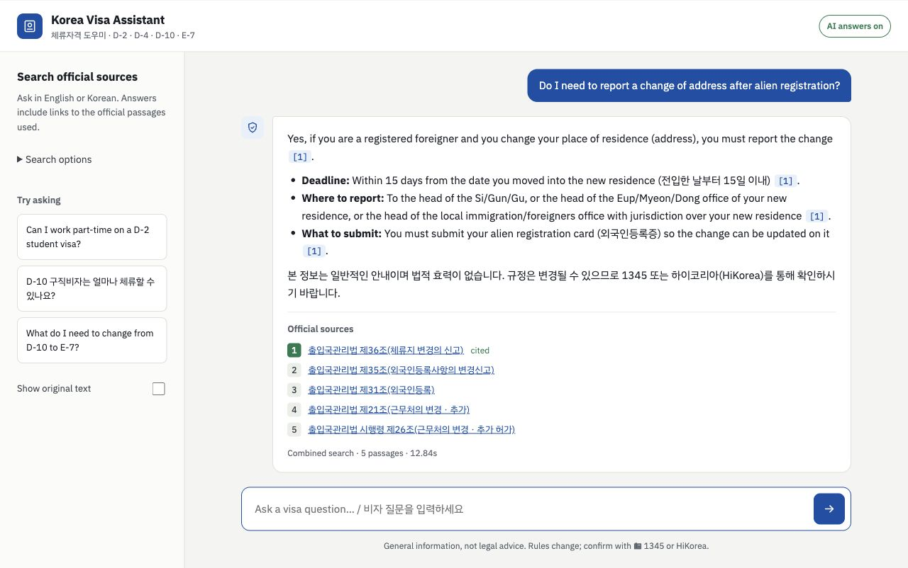

# 🛂 Korea Visa Assistant · 체류자격 도우미

A citation-first RAG assistant, available as a **web app** and a **Telegram bot**, that answers
questions about Korean student and job-seeker visas (D-2, D-4, D-10, E-7) in **English or Korean**,
using only official government sources.

> 한국어 설명은 [아래](#한국어)에 있습니다.

**Status:** 🚧 In development. Core pipeline, web app and tests are implemented; data collection,
a first statute-corpus retrieval evaluation is complete; public deployment is pending.


*Local statute-only app with a real Gemini answer and official citations, captured 2026-10-24. This is not a public deployment.*

## Why

Visa rules for foreigners in Korea are spread across laws, decrees and HiKorea pages, written in
formal legal Korean. General chatbots answer confidently but often wrongly. This assistant
retrieves the exact article, answers from it, and links to the source for every claim, and it says
"I don't know" when the sources don't cover the question.

## Features

- **Bilingual Q&A:** ask in English or Korean; answers come back in the same language
- **Citations on every claim** with links to the official source, and cited sources highlighted
- **Hybrid retrieval:** Korean keyword search (BM25 + Kiwi) and semantic vector search, fused with RRF
- **Free search-only mode:** runs with no API key, returning the most relevant official passages
- **Optional search controls:** keyword, meaning and combined search, with explanations
- **Telegram bot** sharing the same engine: cited answers, linked sources, `/mode` switching
- **REST API** with auto-generated docs (`/docs`)
- **Evaluation pipeline** (hit@k, recall@k, MRR) and automated tests via GitHub Actions
- Responsive layout with light/dark themes

## How it works

```
data/raw (laws + guides)
   │  article-aware chunking (제N조 / 항 / 호 kept together)
   ▼
chunks.jsonl ──► BM25 (Kiwi Korean tokenizer + visa-code tokens)
             └─► Vector search (Gemini embeddings in Chroma)
                     │
                     ▼  Reciprocal Rank Fusion
                 top-5 chunks ──► LLM answer with [n] citations
                                        │
                     ┌──────────────────┴──────────────────┐
                     ▼                                     ▼
                  FastAPI                            Telegram bot
                   ├─ /api/ask, /api/search            (long polling,
                   └─ web front end (HTML/CSS/JS)        HTML replies)
```

One engine (`VisaAssistant`), two interfaces: the web app for browsers and recruiters,
the Telegram bot for people who want quick answers in a messenger.

Source document headers preserve URL anchors for links to specific sections.
See [the source format](data/raw/README.md) when adding documents.

| Problem | Choice |
|---|---|
| Fixed-size chunks cut legal rules in half | Split by article (조), keep paragraphs (항) and items (호) together |
| Korean particles break keyword search ("비자를" ≠ "비자") | Kiwi morphological analyzer for BM25 |
| "D-10" gets tokenized as "D", "-", "10" | Extract visa codes as single tokens first |
| Keyword search misses paraphrases, vector search misses exact codes | Hybrid retrieval with RRF |
| Hallucinated answers | Sources-only prompt, mandatory citations, explicit abstain path |
| API cost for a demo | Free search-only mode when no key is set |

## Results

Measured on 2026-10-24 with `python eval/run_eval.py`: 22 statute chunks,
11 labeled in-scope questions, and one excluded out-of-scope question. Five
in-scope questions have partial source coverage and remain in the scores.
These retrieval metrics do not measure legal answer accuracy. This small set
has not been independently annotated. See [labels](eval/LABELING.md) and the
[saved report](eval/public_baseline.json).

Use `python eval/run_eval.py --k 10` to score the top 10 results. `--k` must be a positive integer.

| Retrieval | hit@5 | recall@5 | MRR |
|---|---|---|---|
| BM25 | 0.818 | 0.636 | 0.818 |
| Vector | 1.000 | 0.939 | 0.848 |
| Hybrid (RRF) | 1.000 | 0.909 | 0.939 |

For the free Render profile, `KIWI_LIGHTWEIGHT=true` keeps real Kiwi morphology
with optional dictionaries disabled. Its measured keyword-search scores match
the BM25 row above; see [free-profile report](eval/free_baseline.json).
The free host uses keyword retrieval, sleeps when idle, and discards generated
files and usage counters on restart. Use a Free-tier Gemini project for AI
answers without provider charges. See [free hosting details](docs/DEPLOYMENT.md#free-render-deployment).

## Quick start

```bash
python -m venv .venv && source .venv/bin/activate
pip install -r requirements.txt
cp .env.example .env            # optional: add GEMINI_API_KEY; LAW_API_OC for law download

python scripts/fetch_laws.py    # optional: download laws if LAW_API_OC is configured
python scripts/build_index.py   # chunk (+ embed if a Gemini key is set)
uvicorn visarag.api:app --reload --app-dir src
# open http://localhost:8000      API docs: http://localhost:8000/docs

pytest -q                        # tests (no API key needed)
python eval/run_eval.py          # public corpus; build its separate cache first (see eval/LABELING.md)
```

Get a Gemini key from [Google AI Studio](https://aistudio.google.com/apikey) and set
`GEMINI_API_KEY` in your local `.env`. The backend uses Google's `google-genai` SDK for
answers and embeddings. Without this key, it returns BM25 search results and sources.
The key stays on the backend; neither the browser nor Telegram users need it.
Set `SEARCH_ONLY=true` in `.env` to disable Gemini calls even when a key is saved.
Restart the server after changing `.env`.
The website calls this mode **Source search** and shows original passages by default.
The **Search options** section explains the available methods without requiring RAG terminology.

Four official HiKorea guide extracts for D-2, D-4, D-10 and E-7 are included in
`data/raw/`, from the residence manual dated October 19, 2026. You can build an index
from these files without a law API account. For a fully local run, set
`SEARCH_ONLY=true`, run `python scripts/build_index.py --no-embed`, then start the web server.
Source provenance, extraction details and the guide's separate license are in
[data/SOURCES.md](data/SOURCES.md). Keyword search works best with Korean terms and visa codes.

`GEMINI_CHAT_MODEL` defaults to the pinned `gemini-3.5-flash-lite` model. Requests have a
60-second timeout and no automatic retries. `GEMINI_EMBED_MODEL` defaults to the text-only
`gemini-embedding-001`, which returns one vector per input text. Other embedding models may
need different input handling. Rebuild with `python scripts/build_index.py` after changing
embedding providers or models; old vectors cannot be reused with a different embedding space.

### Public demo package

Docker uses only the 22 official statute chunks in `data/public_raw/`. The
HiKorea manual and local extracts are excluded, along with `.env` and local
indexes. See [source scope and reuse basis](data/public_raw/README.md).

```bash
docker build -t korea-visa-rag .
docker run --rm -p 8000:8000 -e SEARCH_ONLY=true korea-visa-rag
```

Startup never embeds documents. An explicit `python scripts/build_index.py`
preparation job builds or resumes a model/corpus-specific cache. Keep generated
data on a persistent volume. With a key but no complete vector cache, Gemini
answers use keyword retrieval until the preparation job finishes and the app
restarts. See [deployment instructions](docs/DEPLOYMENT.md) for persistent
storage, secret settings, and API usage limits.

The pushed Docker image configuration passed its GitHub Actions smoke test;
Docker remains unavailable locally. A Render Blueprint is prepared in
`render.yaml`, using the Free plan without a paid disk. Sign-in and a public
deployment URL are still needed. The new lightweight profile awaits its CI run.

### Telegram bot

1. On Telegram, message **@BotFather**, send `/newbot`, and copy the token into `.env` as `TELEGRAM_BOT_TOKEN`.
2. Build the index (above), then run:

```bash
PYTHONPATH=src python -m visarag.telegram_bot
```

Commands: `/start`, `/help`, `/mode hybrid|bm25|vector`. Any other message is treated as a question.
The bot uses long polling, so it needs no public URL. Without a Gemini key it runs in search-only mode.

## API

```bash
curl -X POST localhost:8000/api/ask -H "Content-Type: application/json" \
     -d '{"question": "Can I work part-time on a D-2 visa?", "mode": "hybrid"}'
```

Returns the answer, the mode used, cited source numbers, and each source's citation, URL and text.
Questions are trimmed before validation and must contain 2 to 500 characters after trimming.
Invalid questions return HTTP 422 before the assistant runs.
API requests are limited per client and paid usage has a persistent daily request cap.
Gemini quota and connection failures return safe, readable errors.
`GET /api/search?q=D-10` returns source passages without generating an answer.
Its `q` parameter follows the same trimming and length rules as questions.

## Project structure

```
src/visarag/
  documents.py   load raw files + metadata
  chunking.py    article-aware Korean law chunker
  tokenizer.py   Kiwi tokenizer + visa-code extraction
  retrieval.py   BM25, vector (Chroma), hybrid (RRF)
  llm.py         Gemini embedding/chat wrappers
  assistant.py   retrieve → prompt → cited answer (or search-only)
  metrics.py     hit@k, recall@k, MRR
  api.py         FastAPI app: JSON API + serves the web front end
  telegram_bot.py Telegram bot interface (same engine)
web/             index.html, styles.css, app.js (no build step)
scripts/         fetch_laws.py, build_index.py, find_chunks.py
eval/            questions.jsonl, run_eval.py
tests/           unit + API tests
```

## Roadmap

- [x] Article-aware chunking, Korean tokenizer, hybrid retrieval
- [x] Cited answers, search-only mode, web app, REST API, tests, CI
- [x] Telegram bot interface
- [x] Collect HiKorea guides for D-2, D-4, D-10, E-7
- [x] Label the existing 12 questions and publish the first statute-corpus results
- [ ] Expand to 30+ questions and independently review answer quality
- [ ] Deploy a public demo
- [ ] Cross-encoder reranker, Upstage Solar comparison

**Disclaimer:** general information, not legal advice. Confirm with the Immigration Contact Center (☎ 1345).

---

## 한국어

외국인 유학생·구직자 비자(D-2, D-4, D-10, E-7)에 대한 질문에 **공식 정부 자료만을 근거로** 답하는 RAG
기반 웹 서비스입니다. 모든 답변에 출처(법령 조문, 링크)를 표시하며, 자료에 없는 내용은 모른다고 답합니다.

**현재 상태:** 개발 중. 핵심 파이프라인, 웹 앱, 테스트는 구현되었으며 데이터 수집, 평가, 배포를 진행하고 있습니다.

**주요 기술적 특징**

- **조문 단위 청킹:** 법령을 고정 길이가 아닌 조(條) 단위로 분할하여 항·호가 한 청크에 유지되도록 했습니다.
- **한국어 형태소 분석:** Kiwi로 조사를 분리하여 BM25 키워드 검색 정확도를 높였습니다.
- **비자 코드 인식:** "D-10", "E-7-1" 같은 코드를 하나의 토큰으로 처리합니다.
- **하이브리드 검색:** BM25와 임베딩 검색 결과를 RRF로 결합했습니다.
- **무료 검색 모드:** API 키 없이도 관련 공식 조문을 검색해 보여줍니다.
- **웹 서비스:** FastAPI 백엔드와 반응형 웹 프론트엔드, REST API를 제공합니다.
- **텔레그램 봇:** 같은 엔진을 사용하는 텔레그램 봇으로도 질문할 수 있습니다.

실행 방법은 위의 Quick start를 참고해 주세요.

**면책:** 본 서비스는 일반 정보 제공용이며 법률 자문이 아닙니다. 정확한 내용은 외국인종합안내센터(☎ 1345)에 확인하세요.
