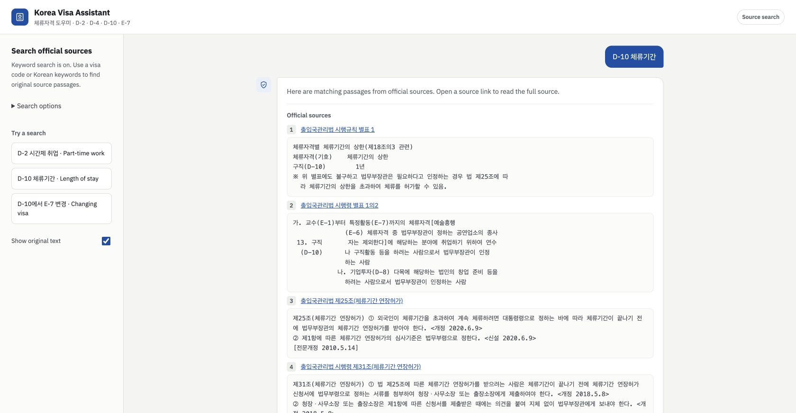

# Google Cloud release record, 2026-10-25

Sean approved provisioning, a production build and private Cloud Run verification
after reviewing `GOOGLE_CLOUD.md`. Public access, AI activation and billing
upgrades are excluded. No Git staging, commit or push is part of this work.

## Verified account and infrastructure

- Project: `YOUR_PROJECT_ID`, number `YOUR_PROJECT_NUMBER`, active.
- Billing: enabled on the previously inspected Free Trial account. No upgrade.
- Region: `us-central1`.
- Private bucket: `YOUR_PROJECT_ID-visa-data`.
  Public access prevention is enforced and uniform bucket-level access is enabled.
- Lifecycle: deletes only `build/source/` staging objects after 14 days.
- Artifact Registry: Docker repository `visa`.
- Runtime account: `visa-runtime@YOUR_PROJECT_ID.iam.gserviceaccount.com`.
  Storage viewer grant is conditional on the `releases/` object prefix.
- Build account: `visa-builder@YOUR_PROJECT_ID.iam.gserviceaccount.com`.
  Storage viewer grant is conditional on `build/source/`; registry writer is
  repository-scoped. It also has log-writer and service-usage-consumer roles.
- Monthly alert: ₩5,000, thresholds 50/90/100%, excludes credits.
  Budget ID: `ab74dd38-4760-4f80-9e93-3424de7de25e`.
  This is a project-wide alert, not a spending cap. Existing CargoCheck storage
  shares this project and was left untouched.

## Durable snapshot and source upload

- SHA-256: `a7d9cb8bdf3e60dc775859f65dba3ce9630d50ff28923fa4829f703257b4960a`.
- Object: `gs://YOUR_PROJECT_ID-visa-data/releases/a7d9cb8bdf3e60dc775859f65dba3ce9630d50ff28923fa4829f703257b4960a.json`.
- Pinned generation: `1792938148800368`.
- Size: 1,551,617 bytes. Contains 22 public chunks and saved vectors.
- Reviewed source copies are under `documents/<snapshot-sha>/`, in the same
  private bucket. Runtime has no read grant for that prefix.
- Cloud Build's source allowlist contained 46 files totaling 98.1 KiB before
  compression. No `.env`, private local corpus, index cache or Git history.

## Build and deployment status

Production build submitted:
`f4015bf6-099b-4bdf-bfcb-a3ad3e1f5e2b`.
[Build details](https://console.cloud.google.com/cloud-build/builds;region=us-central1/f4015bf6-099b-4bdf-bfcb-a3ad3e1f5e2b?project=YOUR_PROJECT_NUMBER).

Build succeeded, including container secret-exclusion, health, homepage and
cited-search checks on Python 3.11/Linux with a 1 GiB memory limit.

- Image digest: `sha256:00171ff917a35ba97255bdac94c63fa9fc7d65d9528a0f3b4cb5353f16d2efe7`.
- Image: `us-central1-docker.pkg.dev/YOUR_PROJECT_ID/visa/app@sha256:00171ff917a35ba97255bdac94c63fa9fc7d65d9528a0f3b4cb5353f16d2efe7`.
- Registry-reported image size: 287,301,592 bytes. One image fits the published
  0.5 GiB storage allowance if it is otherwise unused across the billing account;
  retained releases and other workloads can change that.
- Service: `korea-visa-rag`.
- Private URL: `https://korea-visa-rag-jwq77bpivq-uc.a.run.app`.
- Active revision: `korea-visa-rag-00001-pfp`, 100% traffic.
- Fresh-instance verification revision: `korea-visa-rag-restore2`, no traffic.
  Both revisions logged the same snapshot digest, 22 chunks and `vectors: True`.
  Its authenticated health check passed and its temporary test tag was removed.
- Configuration: 1 vCPU, 1 GiB, request-based CPU, concurrency 1, 180-second
  timeout, service/revision minimum 0 and maximum 1, one Uvicorn worker.
- Mode: `SEARCH_ONLY=true`, no Gemini secret attached and no AI activation.

Live authenticated checks passed:

- Homepage and health return 200; health shows 22 chunks, AI disabled, BM25 only.
- Korean question returns five official source passages; English D-2 question
  returns two. This checks retrieval, not bilingual AI-answer quality.
- An unrelated weather question returns no matching passages.
- Blank input returns 422. `POST /api/ingest` returns 404.
- Repeated requests trigger 429 with `Retry-After: 60`.
- An unauthenticated health request returns 403; service IAM has no public binding.
- The bucket enforces public access prevention. Runtime retrieved the pinned
  object successfully through its prefix-scoped identity.
- The deployed frontend was checked through an authenticated Cloud Shell proxy;
  a real D-10 search rendered five official source links and their text.



This is the actual private cloud deployment in search-only mode, viewed through
an authenticated proxy. It is not a public URL or an AI-generated answer.

No public publication, paid-AI enablement or billing upgrade was performed.
The trial credit balance after these operations has not been remeasured; costs
can appear later. The budget is an alert, not a spending cap.

## Access and rollback

The private URL does not automatically accept a normal browser's Google login.
Use the authenticated CLI proxy from the deployment guide:

```bash
gcloud run services proxy korea-visa-rag \
  --project=YOUR_PROJECT_ID --region=us-central1 --port=8081
```

Then open `http://127.0.0.1:8081` on the machine running that command. If it runs
in Cloud Shell, use Web Preview on port 8081 instead. This does not grant public
Cloud Run access.

Keep the pinned image and snapshot generation. A future rollback to this release:

```bash
gcloud run services update-traffic korea-visa-rag \
  --project=YOUR_PROJECT_ID --region=us-central1 \
  --to-revisions=korea-visa-rag-00001-pfp=100
```
